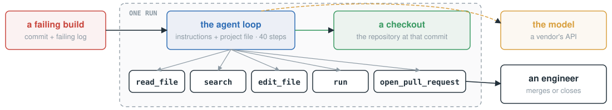

# Measure the build-fixing agent

A company runs 600 internal repositories. When a build fails on main, a coding agent gets the repository at that commit and the failing log, fixes the code, and opens a pull request that an engineer merges or closes. The agent is built, as drawn. Design how its quality is known, before launch and live.

| Quantity | Value |
|---|---|
| **Failing builds** | about 900 a week across the 600 repositories |
| **Past fixes** | 40,000 merged commits over five years, each one fixing a failing build |

**Task**

1. **Measurement before launch.** The task suite: where tasks come from, slices with an example each, a task's starting state and success check, and what must never happen.
2. **Architecture.** Draw the sandbox and the suite runner: what a run can reach, and what it must not.
3. **Measurement once live.** Signals with no held-out check, and which runs a person labels.

**Your design should handle**

1. A task built from a past fix whose commit is still in the history the agent checks out.
2. A run that makes the build pass by marking the failing test as skipped.
3. A test that fails 1 run in 10 with no change to the code.
4. A new model version from the vendor, with no change to your code.
5. A pull request that passes the build, is merged, and is reverted two days later.
6. A build that failed because the package registry was down.

**(Bonus)** The number of runs per task, and what the suite costs to run once.

**One question.** A teammate proposes one launch metric: the share of the agent's pull requests whose build passes. What does it miss, and what in your design catches it?
